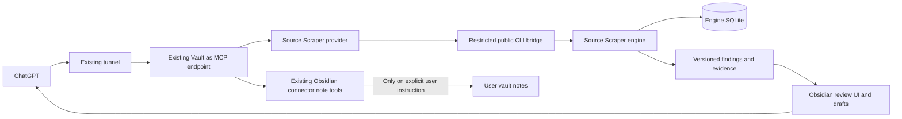

# Source Scraper ChatGPT and Obsidian integration

Updated November 1, 2026. This is the current implementation plan and ownership contract. The user's later explicit instruction supersedes the earlier proposed Source Scraper note-promotion feature: **this project never creates or changes vault notes, including final new notes. ChatGPT writes through the separate existing Obsidian connector only when the user orders it.**

## Goal and boundaries

ChatGPT accepts a research request, uses composable Source Scraper tools to collect authorized observations and inspect evidence, compares candidates with selected reference notes, records separate recommendations, and shows the candidates in Obsidian. It can consume the returned structured findings or read-only Markdown drafts. A later explicit user order is fulfilled through the existing Obsidian connector's tools and permissions, not by Source Scraper.

The engine owns normalization, deduplication, deterministic assessment, SQLite, provenance and public JSON contracts. The independent plugin owns review UI, trusted CLI invocation, staged references and draft presentation. Vault as MCP owns the authenticated existing endpoint, tool registry and note ACLs. The existing tunnel transports requests. ChatGPT remains the orchestrator; no internal model, new agent, scheduler, mandatory repository or second server is introduced.

Existing notes, references, canvases, old databases and legacy plugin state are not project-owned. Development may change the explicitly authorized repositories and plugin installation/configuration; that authority does not extend to user notes. Tests use synthetic vaults. Personal-vault acceptance consists of load, discovery, collection, staging, visual inspection and unchanged-content verification, with zero note creation.

## Established baseline

The audited engine main is 0f9271c / package 0.14.0. The independent plugin baseline is 59fd058 / 1.0.0. The user's existing local engine checkout is older, 1e5c2e9 / 0.4.0, with embedded x-feed-scraper source and no installed root plugin. The existing host is Vault as MCP 1.2.0. The local tunnel has uncommitted 0.9.0 development beyond its 0.8.2 Git base; that work is preserved.

The independent plugin is installed as a development checkout at the existing source-scraper plugin location. The old engine checkout is preserved under a separate legacy development directory; it is not deleted or migrated. Current engine development remains separate from the plugin installation. Exact private paths, backup inventories, deployment digests and acceptance receipts belong in private local evidence, not public repository documentation.

## Integration route and owners

The host originally hardcoded tool definitions and dispatch. The local extension adds a versioned trusted-provider registry to that same host, with explicit local provider enablement, namespaced definitions, collision rejection, disposal and live enablement checks. Remote calls cannot register code or grant capabilities. Class-based provider handlers retain their instance binding. The existing HTTP authentication and note tools remain in place. Clients with cached inventories must rediscover tools; no silent client refresh is assumed.

| Owner | Files and responsibilities |
| --- | --- |
| Engine | Public CLI in apps/collector/source-cli.ts; separate agent assessment implementation/schema; exact selected export; existing entity v1 unchanged |
| Independent plugin | src/cli-bridge.ts, src/mcp-provider.ts, existing contracts, read-only mapping/rendering, review UI and local settings |
| Existing MCP host | ToolProviders registry, handler dispatch, host registration API, lifecycle and ACL adapter, authenticated HTTP regression tests |
| Existing tunnel | Preserve its working transport and unrelated local changes; no transport rewrite required |

## Tool contract

The active surface contains 15 source_scraper-prefixed tools: capabilities, list_projects, validate_project, create_project, run_project, get_run_status, cancel_run, list_findings, inspect_finding, reprocess_project, record_ai_assessment, list_assessments, stage_findings, get_review_queue and preview_selected_notes.

There is no save_selected_notes operation or source-owned write authorization. Preview returns proposed paths/content and existing-path indicators only. ChatGPT may use these as data for a later user-authorized connector action. No write token, receipt, note lifecycle or existing-note ownership is maintained by this project.

Project IDs resolve through a locally configured trusted registry. Source and binary digests are rechecked before commands. Remote project creation admits only configured public-source classes and writes manifests outside the vault. Current remote source capabilities are json-file, json-snapshot, rss, public-json, public-product and locally registered x-for-you-local projects. The optional X provider has a separate off-by-default local read grant and [live-acceptance plan](x-feed-implementation-plan.md); its personalized access is not yet verified. Executable/custom sources remain rejected.

The provider requires engine capabilities agent-assessments-v1 and selected-entity-export-v1 and entity schema v1. Basic JSON import remains independent of this extended engine/host compatibility. All tool schemas reject unknown fields. User-supplied executable paths, extension paths, database paths and shell strings are not accepted.

Job request IDs are idempotent and bound to the command/project/limits. Active commands are serialized; local status and cancellation remain callable. Interrupted jobs are marked after restart and never restarted silently. Valid partial engine results are retained on nonzero exit. Queue state contains entity references, not a parallel findings database. Restart restores candidates without source collection.

Queries support bounded limit/offset and existing global search/type/minimum-score filters with engine score/key ordering. No unsupported sort, review filter or snapshot cursor is advertised. Query pages are limited to 500 records, exact selections to 200, imports/drafts to 8 MB and CLI stdout to 9 MB. Limits and source restrictions are reported by capabilities.

## Agent records and contextual quality

New public assessment-record and assessment-list CLI commands store agent judgments separately from evaluator assessments and human reviews. Records include the observed evidence fingerprint, rubric, recommendation, reasons, uncertainties, reference-note paths/hashes and reported actor/model. They are append-only; current evidence and reference changes produce stale indicators. Actor/model metadata is reported rather than attested. Private reference-note bodies are not required in persistent records.

ChatGPT reads only the selected reference notes through the existing connector, derives a rubric for the request, inspects source evidence and records an explainable recommendation. An engine score does not claim universal quality or verified licensing. A recommendation is never approval to write. The Obsidian detail view shows agent recommendations separately from human review and source history.

Entity JSON/NDJSON v1 retains its meanings. Exact key-selected exports use the existing entity envelope. Agent records use a separate versioned schema; evaluator assessmentHistory is not repurposed. Unsupported older engine capabilities fail explicitly.

## Delivery milestones

1. **Preservation and installation.** Verify private backups and source digests; preserve the old engine repository and uncommitted tunnel work; install the independent development plugin using its existing identity. Only authorized code/configuration paths may change. Gate: running UI, recoverable original installation and unchanged user content.
2. **Host registration.** Extend the exact installed host version with trusted local provider API v1. Gate: existing authenticated HTTP discovery/call works, original note tools remain, disabled/unknown providers fail, names cannot collide, handlers survive class-instance registration, and unloading revokes tools.
3. **First collection-to-review flow.** Add typed public CLI calls, jobs, exact entity export and staging. Gate: real MCP calls collect offline and public npm examples, expose provenance and visibly populate the running Obsidian review panel. Zero notes are created.
4. **Permissions and recovery.** Enforce project/binary digests, workspace containment, admitted source capabilities, limits, subprocess cleanup, idempotent requests and queue restoration. Gate: wrong roots/manifests/commands fail before execution; interruption/retry preserves committed data; restart does not collect automatically.
5. **Contextual assessments.** Add separate public records and evidence/reference freshness. Gate: simulated reference comparisons in synthetic acceptance remain visibly separate from human decisions; actual user-specific comparisons require selected references and a real ChatGPT judgment.
6. **Read-only drafts and connector consumption.** Remove source-owned note creation from tools and UI, including the earlier planned promotion action. Gate: draft previews create no paths, no Vault mutation callback is supplied to the provider, unknown save calls fail, and the final write path exists only in the independent connector under user control.
7. **Compatibility and verification.** Run engine/plugin/host type checks, build and meaningful regressions; use real CLI and authenticated HTTP harnesses as well as mocks. Gate: exact candidate checks pass and platform skips/limits are explicit. Personal notes are never a test target.
8. **Device acceptance and handoff.** Reload actual plugins, rediscover the existing endpoint, collect a permitted source, inspect visible candidates, verify restart recovery and compare pre-existing user-content hashes. Gate: zero notes created/changed, working review queue, private deployment evidence and a reversible code rollback. A cached ChatGPT session may still require an existing-connector refresh before new tools appear to that session.

## Verification matrix

| Boundary | Evidence |
| --- | --- |
| Host | Existing endpoint authentication; discovery/call; provider enablement, revocation, collision and instance-binding tests; note ACL regressions |
| Engine | Public CLI tests; exact v1 export; stale assessment rejection; preserved human review; existing full engine suite |
| Bridge | Real binary plus fixtures; UTF-8 boundaries; subprocess errors; partial JSON; redaction; output/time limits; cancellation and running lock |
| Policy | Unregistered project, changed manifest/binary, out-of-root file, unsafe executable source and arbitrary command arguments rejected |
| UI and drafts | Real visible candidate rows match engine IDs/provenance; agent reasons separate; no create-notes controls; draft generation and reimport produce zero files |
| State | Idempotent jobs, interrupted state, persistent staged references and restart without automatic collection |
| User content | Hashes of every pre-existing file outside authorized plugin/configuration areas; no note-creation acceptance tests |
| Connector | Existing independent note permissions retained; refresh/discovery distinguished from server tool availability; explicit user instruction required for any later write |

Windows filesystem fixtures use real directory junctions when unprivileged symlink creation is unavailable, without weakening traversal/reparse-point assertions. Synthetic writer tests retained for historical release compatibility do not make those helpers active runtime capabilities. Linux/macOS/Windows process and filesystem coverage remain distinct from real Desktop acceptance and declared minimum-version compatibility.

## Repository delivery and rollback

Use codex-prefixed branches in the existing engine, independent plugin and MCP-host checkouts. Reviewable changes belong with their contract owner. Do not mix unrelated local tunnel work into integration commits or publish private paths/evidence. Upstream host adoption is not assumed; the tested local host build is recorded by digest. No merge/release or new mandatory repository is implied by local implementation.

Preserve old plugin assets, source trees, Git history, enabled IDs and settings before deployment. Use the app's plugin lifecycle around binary replacement. A failed provider can be disabled; restoring previous host assets returns the endpoint to note-only tools. Restoring code never deletes/restores over user notes or silently rolls back a database containing newer records. Keep the legacy implementation inactive and retained until a separate parity/retirement decision.

## Remaining limits and acceptance meaning

Personalized X For You still lacks an authorized verified provider and is independent of generic delivery. The current remote source allowlist intentionally excludes executable/custom adapters. Existing JSON import is independent of the extended MCP host. Real semantic comparison requires a user-selected sample and actual ChatGPT evaluation; simulated tests are labeled as such. Existing client tool inventories can require reconnect/re-discovery.

Completion means verified collection/evidence/assessment/staging/draft consumption through the existing MCP endpoint and running review UI, with recovery and zero project-owned vault-note mutations. Later writes remain exclusively a user-directed ChatGPT/Obsidian-connector action.
